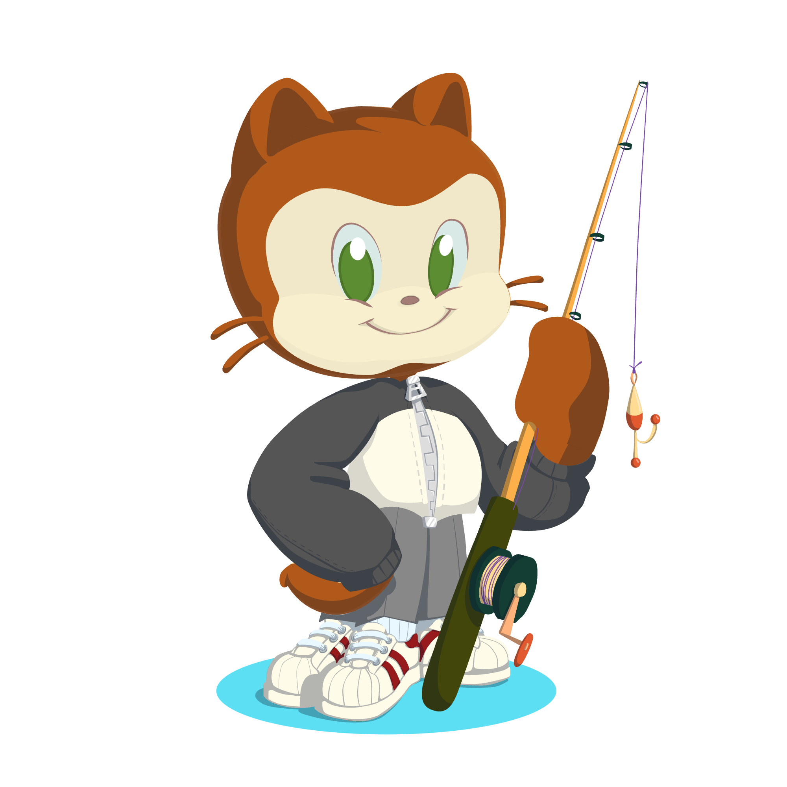

    

 
    

##  Overview

-  Working towards **OSCP**, with a focus on hands-on labs
-  **Reverse engineering certified**, with a **CVE to my name**
- Building AI projects, from **small language models** to **local Ollama experiments**
-  Web development experience, including projects built with **React**
-  Still making time for **C, systems programming, and hardware experiments**

<h3 align="center">Security, reverse engineering &amp; building things</h3>

###  GitHub Stats

### 💻 Most Used Languages

## Tech Stack

### Languages & Tools

##  Connect With Me

## About Me

I'm Nish. My background is in networking, development and security, and I'm currently working towards OSCP.

I've earned a reverse engineering certification and have a CVE to my name. I like taking software apart to understand how it works, then using what I learn in my own projects.

I've also built web apps and several AI projects. Lately, that has meant experimenting with local models through Ollama and getting a better understanding of how language models work. Some of the repos here are finished projects; others are experiments I'm still working through.

### Projects

- [Ollama experiments](https://github.com/airbuff/Ollama_Exp) — running models locally and using Python to send code to an LLM for analysis.
- [NanoGPT](https://github.com/airbuff/NanoGPT) — building and training a small GPT implementation, following Andrej Karpathy's work.
- [MNIST digit recognition](https://github.com/airbuff/MNIST-Digit-recognition-app) — a handwritten digit recognition project.
- [Source Code Learning App](https://github.com/airbuff/SourceCodeLearningApp) — a React project for learning about source code.

### Current Interests

- Penetration testing and OSCP labs
- Reverse engineering and vulnerability research
- Local AI and small language models
- Web development and systems programming

---

###  Profile Views

